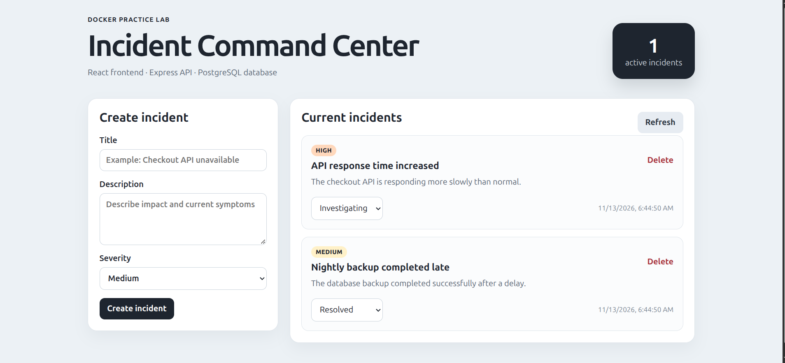
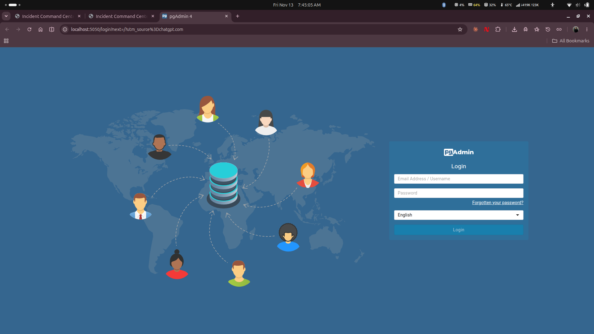
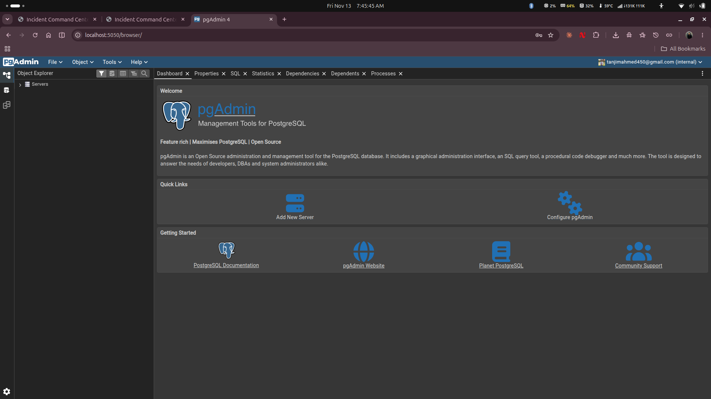
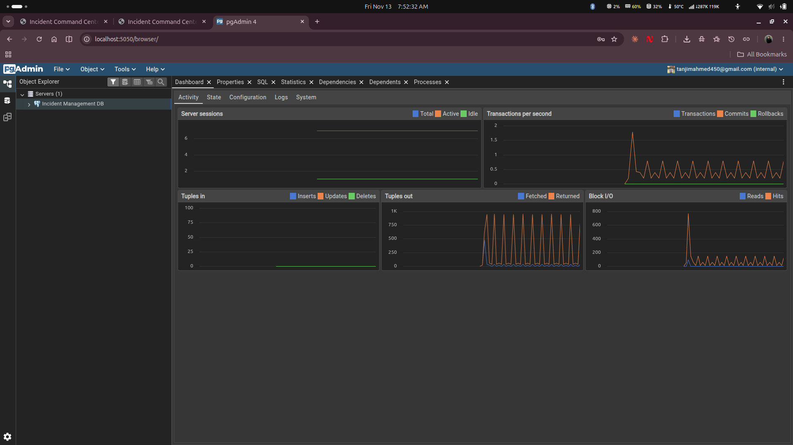
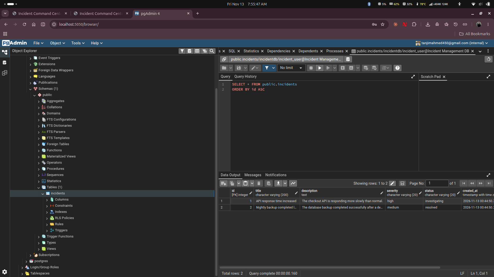
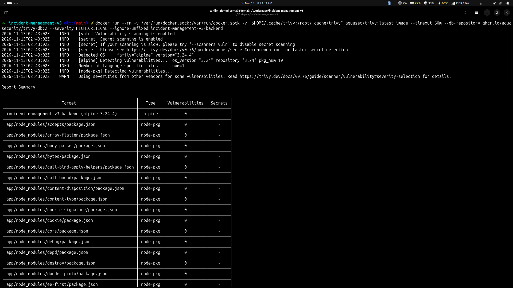
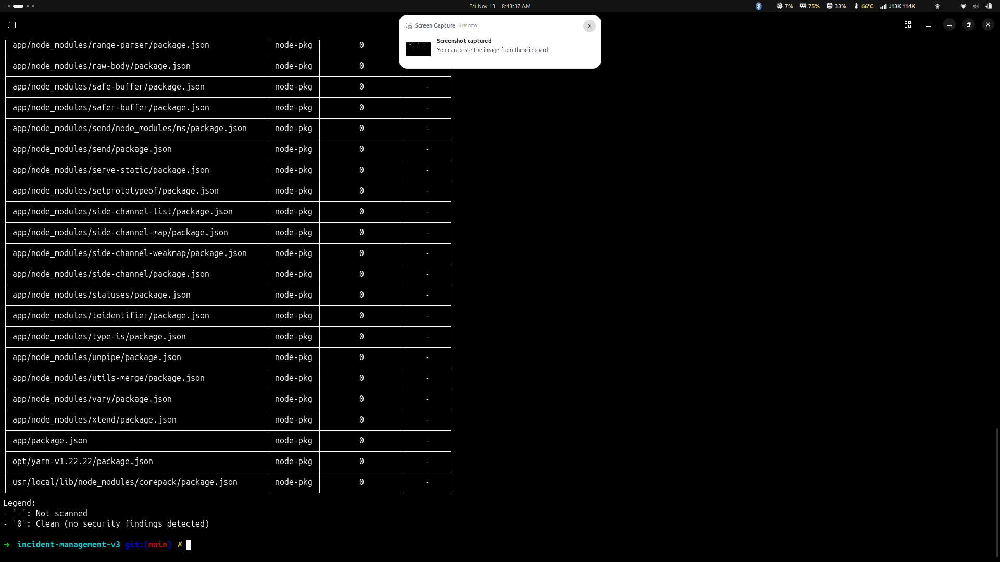
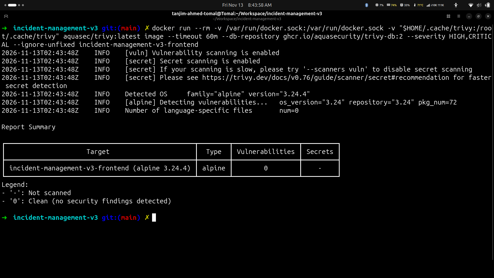

 <div align="center">

# Incident Management — Dockerized Application

**A Full-Stack Application Containerized with Docker**

[](https://www.docker.com/)
[](https://docs.docker.com/compose/)
[](https://react.dev/)
[](https://nodejs.org/)
[](https://www.postgresql.org/)

</div>

---

## Overview

Incident Management V3 is a full-stack application containerized using Docker and orchestrated with Docker Compose.

The project separates the frontend, backend, and PostgreSQL database into independent containers. It demonstrates production-oriented containerization, multi-stage builds, persistent storage, health checks, development workflows, resource management, and container image security scanning.

This project is the third stage of my Incident Management DevOps learning series.

## Features

- React frontend served through Nginx
- Node.js and Express backend
- PostgreSQL database with persistent storage
- Multi-container orchestration using Docker Compose
- Separate Development and Production environments
- Multi-stage Docker builds
- Non-root backend container execution
- Container health checks and service dependencies
- Environment-based configuration
- Docker Compose resource limits
- Optional pgAdmin service using Compose profiles
- Trivy vulnerability scanning
- Optimized production images

## Technology Stack

| Layer | Technology |
|---|---|
| Frontend | React, Vite |
| Backend | Node.js, Express.js |
| Database | PostgreSQL 16 |
| Web Server | Nginx |
| Database Administration | pgAdmin |
| Containerization | Docker |
| Orchestration | Docker Compose |
| Security Scanning | Trivy |
| Base Images | Node.js Alpine, Nginx Alpine |
| Development Environment | Linux |

## Architecture

The application follows a multi-container architecture.

```text
                    User
                      |
                      v
              Frontend Container
                  Nginx :80
                      |
                 /api Requests
                      |
                      v
              Backend Container
                Express :5000
                      |
                      v
              Database Container
               PostgreSQL :5432
                      |
                      v
               Persistent Volume
```

Docker Compose manages container networking, service dependencies, health checks, and persistent storage.

## Project Structure

```text
incident-management-v3/
├── backend/
│   ├── src/
│   │   ├── db.js
│   │   └── server.js
│   ├── Dockerfile
│   └── .dockerignore
│
├── frontend/
│   ├── src/
│   ├── Dockerfile
│   ├── nginx.conf
│   ├── vite.config.js
│   └── .dockerignore
│
├── screenshots/
│   ├── screenshot-01.png
│   ├── screenshot-02.png
│   ├── screenshot-03.png
│   ├── screenshot-04.png
│   ├── screenshot-05.png
│   ├── screenshot-06.png
│   ├── screenshot-07.png
│   └── screenshot-08.png
│
├── compose.yaml
├── compose.dev.yaml
├── .env.example
├── .gitignore
└── README.md
```

## Getting Started

### Prerequisites

- Docker Engine
- Docker Compose
- Git

### 1. Clone the Repository

```bash
git clone https://github.com/tanahmeeedsx/incident-management-v3.git
cd incident-management-v3
```

### 2. Configure Environment Variables

Create your environment file from the example:

```bash
cp .env.example .env
```

Update the values in `.env` with your own credentials.

Keep `.env` out of version control.

### 3. Production Deployment

Build the production images:

```bash
docker compose build
```

Start the application:

```bash
docker compose up -d
```

Check container status:

```bash
docker compose ps
```

### 4. Development Environment

Start the development environment separately:

```bash
docker compose -p incident-management-dev -f compose.dev.yaml up -d
```

The development setup uses Vite's development server, Node.js watch mode, and PostgreSQL.

Access the development application:

`http://localhost:5173`

Stop the development environment:

```bash
docker compose -p incident-management-dev -f compose.dev.yaml down
```

## Application Access

| Service | URL |
|---|---|
| Production Frontend | http://localhost:8080 |
| Incidents API | http://localhost:8080/api/incidents |
| Development Frontend | http://localhost:5173 |
| pgAdmin | http://localhost:5050 |

The backend health check runs internally inside the backend container.

## Project Screenshots

### Application Interface



### Development and Container Management





### Database Administration — pgAdmin





### Security Scanning — Trivy

**Backend Image Scan**



**Frontend Image Scan**





## Database Administration with pgAdmin

pgAdmin is configured as an optional service using Docker Compose profiles.

Start the application with pgAdmin:

```bash
docker compose --profile tools up -d
```

Access pgAdmin:

`http://localhost:5050`

Use the following connection settings when registering the PostgreSQL server:

| Setting | Value |
|---|---|
| Host | db |
| Port | 5432 |
| Database | incidentdb |
| Username | Value of DB_USER |
| Password | Value of DB_PASSWORD |

The pgAdmin service communicates with PostgreSQL through the internal Docker network.

## Resource
